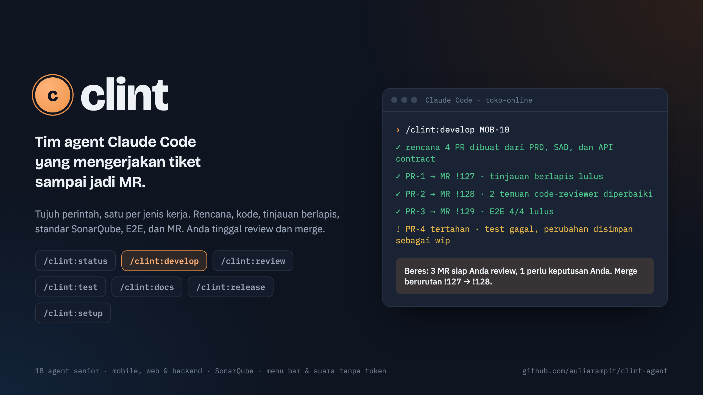
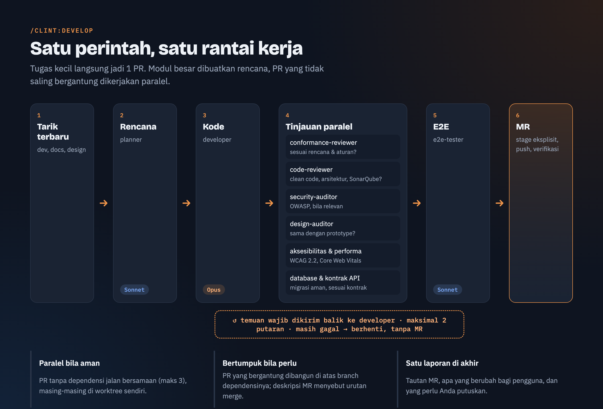
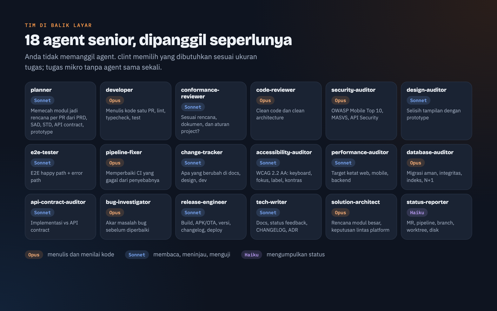
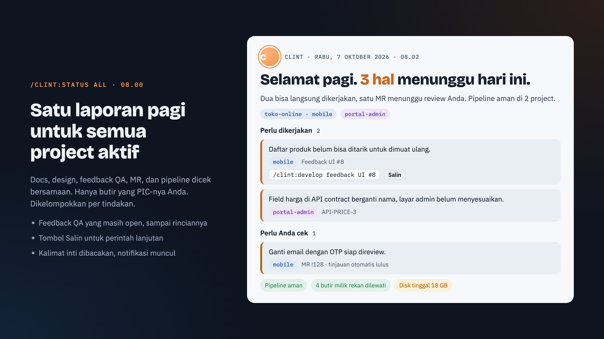
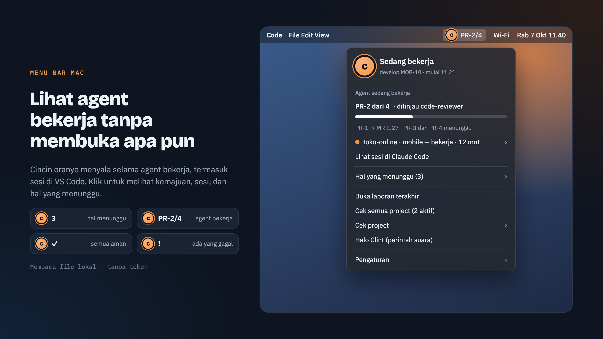
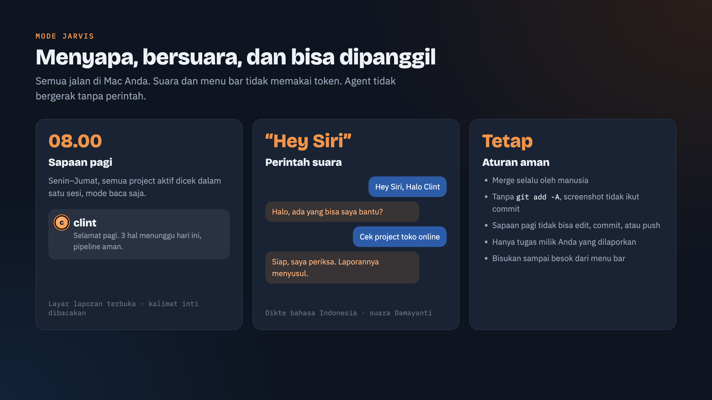

# clint



**clint** adalah plugin Claude Code untuk tim Badr Interactive. Isinya 21 agent senior yang bekerja sebagai
satu tim: membaca dokumen, merencanakan, menulis kode, meninjau berlapis, menguji, merilis, dan menjaga
dokumen tetap sinkron. Dipasang sekali, berlaku di semua project, baik project baru maupun project lama
yang sedang di-enhance.

- **Tujuh perintah, satu per jenis kerja.** Tidak perlu menghafal agent; perintah yang memilih agent.
- **Tinjauan berlapis sebelum MR.** Kesesuaian dokumen, clean code, standar SonarQube, keamanan OWASP,
  aksesibilitas WCAG 2.2, performa, database, kontrak API, dan desain. Temuan wajib diperbaiki otomatis.
- **Lolos SonarQube sejak ditulis.** Standar quality gate Badr ikut diterapkan saat kode ditulis dan ditinjau.
- **Mobile, web, dan backend.** Skill platform yang portabel: konvensi inti + adapter fakta stack per project.
- **Dua bahasa.** Jawaban dan laporan dalam Bahasa Indonesia atau English, sesuai setelan masing-masing orang.
- **Tanpa AI slop.** Kode, commit, MR, dan laporan ditulis seperti engineer senior, bukan terasa buatan mesin.
- **Hemat token.** Agent hanya dipanggil bila menambah nilai; menu bar, suara, dan status tidak memakai token.

---

## Daftar isi

1. [Mulai cepat](#mulai-cepat)
2. [Tujuh perintah](#tujuh-perintah)
3. [Bingung pakai yang mana?](#bingung-pakai-yang-mana)
4. [Contoh lengkap per perintah](#contoh-lengkap-per-perintah)
5. [Panduan per peran](#panduan-per-peran)
6. [Bahasa](#bahasa)
7. [Standar SonarQube](#standar-sonarqube)
8. [Tanpa AI slop](#tanpa-ai-slop)
9. [Cara kerja `develop`](#cara-kerja-develop)
10. [Tim agent](#tim-agent)
11. [Platform: mobile, web, backend](#platform-mobile-web-backend)
12. [Laporan pagi](#laporan-pagi)
13. [Menu bar](#menu-bar)
14. [Mode JARVIS](#mode-jarvis)
15. [Otomatis tanpa perintah](#otomatis-tanpa-perintah)
16. [Hemat token](#hemat-token)
17. [Konfigurasi](#konfigurasi)
18. [Pindah dari clint v1](#pindah-dari-clint-v1)
19. [Tanya jawab](#tanya-jawab)
20. [Struktur repo dan perawatan](#struktur-repo-dan-perawatan)
21. [Peta jalan](#peta-jalan)

---

## Mulai cepat

**1. Pasang plugin** (sekali per laptop; butuh `jq` dan `python3`, mis. `brew install jq`):

```bash
claude plugin marketplace add auliarampit/clint-agent
claude plugin install clint@clint
```

Lalu di VS Code: `Cmd+Shift+P` → **Developer: Reload Window**.

**2. Siapkan project** (sekali per project, oleh satu orang; hasilnya di-commit untuk seluruh tim):

```
/clint:setup mobile        # atau: web, backend, atau gabungan "mobile web backend"
```

Perintah ini:

- menyalin prinsip kerja, skill platform, aturan test, dan standar SonarQube ke `.claude/`;
- mengisi adapter stack dari hasil perintah verifikasi (bukan tebakan);
- membuat `.claude/clint.json` (base branch, cara MR, perintah lint/test, lokasi dokumen, bahasa dokumen);
- menanyakan bahasa pribadi Anda bila belum pernah diatur.

Tidak ada yang di-commit otomatis; periksa dulu hasilnya.

**3. Mulai bekerja:**

```
/clint:status                                   # ada apa hari ini?
/clint:develop perbaiki tombol simpan di profil  # kerjakan sampai jadi MR
```

## Tujuh perintah

| Perintah | Untuk | Contoh |
|---|---|---|
| `/clint:status` | Kondisi kerja: update docs/design dan dampaknya ke kode, feedback QA yang masih open, MR, pipeline, branch, disk. Juga **sisa PR di rencana** dan **sisa tugas sprint** | `/clint:status`, `/clint:status all`, `/clint:status plan`, `/clint:status sprint` |
| `/clint:develop` | Mengerjakan **kode** apa pun sampai jadi MR, dari perbaikan kecil sampai modul penuh | `/clint:develop MOB-10` |
| `/clint:review` | Meninjau kode. Milik sendiri: ditinjau lalu diperbaiki. MR rekan: hanya temuan, tanpa mengubah kode | `/clint:review !123` |
| `/clint:test` | Menguji tanpa mengubah kode produk: menulis dan menjalankan E2E, menutup MR Draft yang E2E-nya tertunda, test case, regresi, laporan bug | `/clint:test e2e draft`, `/clint:test regresi !123` |
| `/clint:docs` | Pekerjaan **dokumen** tanpa kode: BRD/PRD, STD, sprint tracker, status feedback/bug, Status PR di rencana, README, CHANGELOG, ADR | `/clint:docs tandai FB-MOB-008 diperbaiki di !130` |
| `/clint:release` | Build dan rilis: APK/IPA untuk UAT, update OTA, versi, changelog, kesiapan deploy | `/clint:release build APK UAT Android` |
| `/clint:setup` | Pasang clint di project, sinkronkan dengan master (`sync`), atau ganti bahasa (`language id`) | `/clint:setup sync` |

Setiap perintah ditutup dengan blok **Berikutnya**: langkah siap ketik untuk project yang sedang Anda buka
(tidak pernah milik project lain), masing-masing bertanda:

```
Berikutnya (magnet-rezeki/mobile):
[paralel] /clint:develop docs/plans/mr-mob-11.md PR-2,PR-3
[urutan, setelah PR-2,PR-3] /clint:develop docs/plans/mr-mob-11.md PR-4,PR-5,PR-8
[E2E] /clint:test e2e !222 · PR-7
[terblokir] PR-9: seeder api data inbox
Sedang dikerjakan sesi lain: PR-1 (ditinjau)
```

| Tanda | Arti |
|---|---|
| `[paralel]` | saling bebas: ketik satu perintah (develop mengerjakannya bersamaan, maks 3), atau buka satu sesi per PR |
| `[siap]` | satu langkah yang bisa langsung dikerjakan |
| `[urutan, setelah X]` | tunggu X selesai dulu |
| `[lanjutkan]` | PR yang tertahan atau setengah jalan |
| `[E2E]` | MR Draft yang menunggu E2E |
| `[terblokir]` | menunggu pihak lain |

PR yang sedang dikerjakan sesi lain (di laptop yang sama) tidak disarankan lagi. Blok yang sama muncul di
layar laporan dan menu bar (per project), dengan tombol salin.

Anda **tidak perlu memanggil agent** dan tidak wajib mengetik perintah. Kalimat biasa seperti "tolong
perbaiki pipeline MR 123" atau "ada update apa hari ini?" juga dikenali dan diarahkan ke perintah yang tepat.

## Bingung pakai yang mana?

Tanyakan pada diri sendiri: **apa yang akan berubah?**

```
Belum tahu mau mengerjakan apa?          → /clint:status
Kode aplikasi berubah?                   → /clint:develop
Ingin memeriksa kode (sendiri/rekan)?    → /clint:review
Ingin menguji tanpa mengubah kode?       → /clint:test
Hanya dokumen yang berubah?              → /clint:docs
Ingin build, rilis, atau deploy?         → /clint:release
Memasang/memperbarui clint atau bahasa?  → /clint:setup
```

Beberapa contoh yang sering tertukar:

| Permintaan | Perintah | Alasan |
|---|---|---|
| "Perbaiki bug FB-MOB-008" | `develop` | kode berubah |
| "Tandai FB-MOB-008 sudah diperbaiki" | `docs` | hanya dokumen QA berubah |
| "E2E MR !123 masih tertunda" | `test` | menguji, kode produk tidak berubah |
| "Ada 4 MR Draft, tolong tutup" | `test e2e draft` | Draft = E2E tertunda; E2E-nya yang diselesaikan |
| "Rencana MOB-11 tinggal apa?" | `status plan` | membaca status, tidak mengubah apa pun |
| "Buat PRD dari MoM ini" | `docs` | dokumen requirement, tanpa kode |
| "Pipeline !123 merah" | `develop` | perbaikannya mengubah kode/konfigurasi |
| "Build APK untuk UAT" | `release` | build dan distribusi, bukan kode |
| "Cek dulu sebelum MR" | `review` | memeriksa hasil kerja |
| "Ada update docs?" | `status` | mencari pekerjaan |

`status` **mencari** pekerjaan, `review` **memeriksa** hasil pekerjaan, `develop` **mengerjakan**.

## Contoh lengkap per perintah

Semua contoh bisa diketik apa adanya. Bagian setelah nama perintah boleh kalimat biasa; clint memahami
maksudnya. Kolom "Atau cukup bilang" menunjukkan kalimat tanpa perintah yang hasilnya sama.

### `/clint:status`: kondisi kerja dan sisa tugas sprint

| Ketik | Hasilnya | Atau cukup bilang |
|---|---|---|
| `/clint:status` | Update docs/design dan dampaknya ke kode, feedback QA yang masih open, MR, pipeline, branch, disk di project ini | "ada update apa hari ini?" |
| `/clint:status all` | Semua project aktif sekaligus, satu layar laporan (sama dengan laporan pagi) | "cek semua project" |
| `/clint:status toko-online` | Kondisi project lain tanpa pindah folder | "gimana kondisi project toko online?" |
| `/clint:status since 1 minggu` | Perubahan seminggu terakhir, bukan hanya 3 hari | "apa saja yang berubah minggu ini?" |
| `/clint:status plan` | Setiap rencana di `docs/plans`: berapa PR selesai, yang setengah jalan/tertahan, Draft, dikerjakan sesi lain, yang siap; plus modul di PRD yang **belum punya rencana** | "sisa tugas di rencana apa?", "modul mana yang belum direncanakan?" |
| `/clint:status plan MR-MOB-11` | Hanya rencana modul itu, lengkap per PR | "MOB-11 tinggal PR apa?" |
| `/clint:status sprint` | Sisa tugas **sprint yang sedang berjalan** (dipilih dari tanggal sprint), dikelompokkan: terblokir/bug → sedang dikerjakan/QA → belum mulai | "sprint saat ini yang belum selesai apa?" |
| `/clint:status sprint saya` | Sama, hanya butir yang PIC-nya Anda | "tugas saya di sprint ini yang belum apa?" |
| `/clint:status sprint 3` | Sisa tugas Sprint 3 | "sisa tugas sprint 3 apa saja?" |
| `/clint:status sprint 1 2 3 4` | Sisa tugas beberapa sprint, dijawab per sprint | "sprint 1 sampai 4 yang belum selesai apa?" |
| `/clint:status sprint Hafizh` | Butir sprint berjalan milik rekan tertentu | "Hafizh masih pegang apa di sprint ini?" |

Mode sprint membaca sprint tracker di `docs.pic` (`.claude/clint.json`), misalnya `docs/sprints/s09.md`. Mode ini
hanya membaca dan tidak memanggil agent, jadi cepat dan murah. Status dibaca dari kolom tabel (⬜ 🔄 🧪 🐞 🚫 ✅,
atau kata seperti Open/In Progress/Done) dan checklist `- [ ]`. Project belum mengisi `docs.pic` → clint
menanyakan letak sprint tracker-nya. Mengubah isi tracker (centang, status, PIC) lewat `/clint:docs`.

MR yang menunggu peer review ditandai mengikuti eskalasi standar Badr: ⚠ lebih dari 3 jam (kabari SA) dan 🔴
lebih dari 5 jam (kabari engineer lead), baik MR Anda maupun MR rekan yang reviewer-nya Anda. Hanya MR non-Draft
tanpa approval yang dihitung, sejak MR dibuat. clint hanya menandai; notifikasi ke SA/lead tetap urusan tim atau
bot di server.

### `/clint:develop`: mengerjakan kode sampai MR

| Ketik | Hasilnya |
|---|---|
| `/clint:develop perbaiki tombol simpan di layar profil tidak aktif` | Tugas kecil, langsung 1 PR dan 1 MR, tanpa file rencana |
| `/clint:develop perbaiki FB-MOB-008` | Satu butir feedback/bug, dicari di dokumen QA |
| `/clint:develop MOB-10` | Modul baru: rencana per PR dibuat dari PRD/SAD/API contract, lalu dikerjakan maksimal 3 PR per run |
| `/clint:develop docs/plans/mob-10.md` | Lanjutkan rencana; PR yang sudah merged dilewati |
| `/clint:develop docs/plans/mob-10.md PR-4..PR-6` | Hanya PR tertentu |
| `/clint:develop ../docs/qa/feedback/feedback-fitur-mobile.md` | Semua butir feedback yang masih open di file itu |
| `/clint:develop terapkan saran reviewer di !123` | Tindak lanjut MR; push ke MR yang sama |
| `/clint:develop perbaiki pipeline !123` | CI merah (lint, test, build, quality gate SonarQube) |
| `/clint:develop` (tanpa argumen, setelah `status`) | Kerjakan temuan "perlu dikerjakan" dari laporan `status` barusan |

Modul besar dikerjakan bertahap. Setelah 3 PR, blok *Berikutnya* berisi perintah lanjutannya; ketik `/clear`
dulu, lalu tempel perintah itu.

**Beberapa sesi sekaligus.** Langkah `[paralel]` boleh dibagi ke beberapa sesi (mis. 3 jendela VS Code untuk PR-1,
PR-2, PR-3). Setiap sesi mengklaim PR-nya di `~/Library/Logs/clint/kerja/<id-sesi>.json`, jadi:
- sesi lain tidak mengambil PR yang sama, dan otomatis memakai worktree (tidak saling `git switch` di folder yang sama);
- sesi yang selesai lebih dulu menyarankan PR berikutnya yang benar-benar tersedia, bukan PR yang sedang
  dikerjakan sesi lain.

**Status di rencana.** Setiap rencana punya bagian `## Status PR` yang diperbarui `develop` di commit PR-nya:

```
- [x] PR-1 · ✅ selesai · MR !212

- [ ] PR-2 · 🔍 menunggu review · MR !213

- [ ] PR-3 · ⏸️ tertahan: test gagal di useFollowUp

- [ ] PR-4 · ⬜ belum mulai
```

Status: ✅ selesai · 🔍 menunggu review · 🧪 Draft, E2E tertunda · ⏸️ tertahan/setengah jalan · 🚫 terblokir ·
⬜ belum mulai. Butir dipisah baris kosong supaya PR paralel yang masing-masing mengubah butirnya sendiri tidak
bentrok saat merge (baris tabel yang berdempetan bentrok). Status 🚫 dan ✅ yang Anda tulis sendiri dipertahankan.

### `/clint:review`: memeriksa kode

| Ketik | Hasilnya |
|---|---|
| `/clint:review` | Perubahan Anda yang belum di-commit + commit branch ini: ditinjau lalu langsung diperbaiki |
| `/clint:review !123` | MR milik rekan: hanya temuan dengan baris kode dan usulan, kode tidak diubah |
| `/clint:review feat/checkout-ulang` | Branch tertentu terhadap base branch |
| `/clint:review !123 --only` | Hanya temuan, walaupun MR milik Anda sendiri |

### `/clint:test`: menguji tanpa mengubah kode produk

| Ketik | Hasilnya |
|---|---|
| `/clint:test login` | Tulis dan jalankan E2E fitur login (happy path + error utama); flow-nya jadi MR |
| `/clint:test e2e !123` | Selesaikan E2E yang tertunda di MR Draft !123; lulus → MR ditandai siap (bukan Draft lagi) |
| `/clint:test e2e !219 !220 !222` | Beberapa MR Draft, dikerjakan **berurutan** |
| `/clint:test e2e draft` | Semua MR Draft milik Anda di project ini, berurutan (maks 3 per run, sisanya di *Berikutnya*) |
| `/clint:test tc MR-MOB-11` | Test case dari AC di PRD, lengkap dengan matriks AC↔TC (`qa-analyst`) |
| `/clint:test regresi !123` | Daftar TC dan flow E2E yang perlu diuji ulang karena perubahan di MR itu |
| `/clint:test bug tombol simpan tidak aktif setelah ganti foto` | Laporan bug di dokumen feedback, format project |

**Menutup MR Draft.** Draft di clint artinya E2E belum dijalankan atau belum lulus, jadi perintahnya selalu
`/clint:test`. Beberapa Draft dikerjakan berurutan, tidak paralel, karena satu simulator dan satu channel
pratinjau E2E hanya bisa dipakai satu MR pada satu waktu; menjalankannya di beberapa sesi bersamaan membuat
hasilnya saling mengganggu. MR yang bertumpuk diuji dari dasarnya dulu. Draft yang muncul di `/clint:status`
dan `/clint:status plan` sudah disertai perintahnya.

Bug yang ditemukan dilaporkan dengan langkah reproduksi; perbaikannya lewat `/clint:develop`.

### `/clint:docs`: dokumen tanpa kode

| Ketik | Hasilnya |
|---|---|
| `/clint:docs tandai FB-MOB-008 diperbaiki di !130` | Status butir feedback diperbarui dengan rujukan MR |
| `/clint:docs tandai MOD-AD-04 kolom QA selesai di sprint 9` | Sprint tracker diperbarui |
| `/clint:docs catat ADR: pembayaran memakai Midtrans Snap` | ADR baru dengan alasan dan alternatif yang ditolak |
| `/clint:docs perbarui CHANGELOG untuk rilis 1.4.0` | CHANGELOG dari MR/commit sejak rilis terakhir |
| `/clint:docs buat MoM dan confirmation list dari notulen ini` (tempel notulennya) | Keputusan, action item, dan pertanyaan terbuka (`business-analyst`) |
| `/clint:docs buat PRD modul MOB-15 dari BRD` | PRD dengan FR/AC ber-ID; dokumen turunan yang terdampak disebut |
| `/clint:docs susun STD modul MOB-15` | STD dan test case yang menunjuk AC (`qa-analyst`) |
| `/clint:docs rekap sprint 9 dan carry-over` | Rekap per PIC dari bukti MR/commit/Status PR, butir pindah ke sprint berikutnya (`sprint-tracker`) |
| `/clint:docs perbarui Status PR di docs/plans/x.md dari git log` | Rencana lama tanpa status: dicocokkan dengan commit di base |
| `/clint:docs logbook` (sebut keputusan atau kendala hari ini bila ada) | Entri hari ini di `docs/logbook/YYYY-MM.md`: dikerjakan (dari commit dan MR Anda), keputusan, kendala, rencana besok |

### `/clint:release`: build dan rilis

| Ketik | Hasilnya |
|---|---|
| `/clint:release build APK UAT Android` | Build dimulai, tautan/ID build dilaporkan (tidak ditunggu sampai selesai) |
| `/clint:release update OTA ke kanal preview` | Update over-the-air ke kanal yang disebut |
| `/clint:release siap deploy backend ke staging?` | Cek kesiapan: migrasi, variabel lingkungan, rencana mundur |
| `/clint:release naikkan versi 1.4.0 dan catatan rilis` | Versi + catatan rilis untuk manusia, bukan daftar commit |

Rilis yang berdampak ke orang lain (kanal QA, store, produksi) hanya dijalankan bila Anda menyebutnya jelas.

### `/clint:setup`: memasang dan merawat clint

| Ketik | Hasilnya |
|---|---|
| `/clint:setup mobile` | Pasang clint di project mobile (juga `web`, `backend`, atau `mobile web backend`) |
| `/clint:setup sync` | Samakan salinan di project dengan versi clint terbaru; isi field baru; rapikan adapter yang membengkak |
| `/clint:setup language id` | Jawaban dan laporan dalam Bahasa Indonesia (`en` untuk English) |

### Pertanyaan sehari-hari

| Pertanyaan | Perintah |
|---|---|
| "Hari ini saya ngerjain apa?" | `/clint:status` |
| "Sprint ini masih sisa apa?" / "Sprint 3 yang belum apa?" | `/clint:status sprint` / `/clint:status sprint 3` |
| "Tugas saya di sprint ini?" | `/clint:status sprint saya` |
| "Ada MR yang nunggu saya review?" | `/clint:status` |
| "Rencana ini tinggal PR apa? Modul mana yang belum direncanakan?" | `/clint:status plan` |
| "Ada MR Draft, tolong tutup semuanya" | `/clint:test e2e draft` |
| "Saya buka 3 sesi, PR mana yang masih bisa diambil?" | `/clint:status plan` (PR yang dipegang sesi lain ditandai 🔄) |
| "Kenapa pipeline MR ini merah?" | `/clint:develop perbaiki pipeline !123` |
| "Kodingan saya sudah layak MR belum?" | `/clint:review` |
| "Tolong review MR teman saya" | `/clint:review !124` |
| "Fitur X sudah bisa diuji?" | `/clint:test X` |
| "Bug ini sudah beres, tolong update dokumen QA" | `/clint:docs tandai <ID> diperbaiki di !<n>` |
| "Butuh APK buat UAT" | `/clint:release build APK UAT Android` |
| "Saya mau jawaban bahasa Indonesia" | `/clint:setup language id` |

## Panduan per peran

clint tidak menanyakan peran Anda dan tidak membatasi apa pun: semua orang boleh memakai semua
perintah. Pilih perintah sesuai **jenis kerjanya**. Tabel ini hanya titik awal.

### Developer (fullstack, mobile, web, backend)

```
pagi     /clint:status                                  → apa yang berubah dan perlu dikerjakan
kerja    /clint:develop MOB-10                           → rencana, kode, tinjauan, E2E, MR
         /clint:develop perbaiki FB-MOB-008               → satu bug, langsung 1 MR
         /clint:develop terapkan saran reviewer di !123   → tindak lanjut MR, push ke MR yang sama
         /clint:develop perbaiki pipeline !123            → CI merah, termasuk quality gate SonarQube
rekan    /clint:review !124                               → temuan untuk MR rekan, tanpa mengubah kode
rilis    /clint:release build APK UAT Android
```

### QA

```
/clint:status                          → MR yang siap diuji, feedback yang masih open
/clint:status sprint saya              → butir QA saya yang belum selesai di sprint ini
/clint:test login                      → tulis dan jalankan E2E fitur login, hasilnya jadi MR
/clint:test e2e !123                   → selesaikan E2E yang tertunda di MR !123
/clint:test e2e draft                  → semua MR Draft, berurutan
/clint:test tc MR-MOB-11               → test case dari AC, dengan matriks AC↔TC
/clint:test regresi !123               → TC yang perlu diuji ulang karena MR itu
/clint:test bug <deskripsi>            → laporan bug sesuai format feedback project
/clint:docs susun STD modul MOB-15
/clint:docs tandai FB-MOB-008 diverifikasi tanggal 20 Okt
/clint:review !123                     → baca temuan teknis sebelum menguji
```

Bug yang ditemukan dilaporkan; perbaikannya lewat `/clint:develop` oleh developer.

### PM dan SA

```
/clint:status                                 → apa yang berubah di docs, design, dan kode; butir milik Anda
/clint:status sprint                          → sisa tugas sprint berjalan, per status dan PIC
/clint:status sprint 1 2 3                    → sisa tugas beberapa sprint
/clint:status plan                            → sisa PR per rencana, modul yang belum direncanakan
/clint:docs buat MoM dan confirmation list dari notulen ini
/clint:docs buat PRD modul MOB-15 dari BRD    → FR/AC ber-ID, dampak ke dokumen turunan
/clint:docs rekap sprint 9 dan carry-over     → dari bukti MR/commit/Status PR, per PIC
/clint:docs tandai MOD-AD-04 kolom QA selesai di sprint 9
/clint:docs catat ADR: pembayaran memakai Midtrans Snap
/clint:docs perbarui CHANGELOG untuk rilis 1.4.0
/clint:review !123                            → apakah implementasi sesuai PRD/API contract
```

Template dokumen per project (`kit/docs/`) dan SAD/API contract dari `solution-architect` masih dikembangkan.
Lihat [Peta jalan](#peta-jalan).

### Designer

```
/clint:status                                 → layar yang berubah di prototype dan dampaknya ke kode
/clint:review !123                            → selisih tampilan dengan prototype (design-auditor)
```

## Bahasa

Ada dua setelan yang terpisah:

| Setelan | Disimpan di | Mengatur | Default |
|---|---|---|---|
| **Bahasa pribadi** | `~/.config/clint/user.json` (laptop masing-masing) | tanya jawab, laporan, kabar suara, **file rencana** | English |
| **Bahasa dokumen project** | `.claude/clint.json` → `docs.language` (repo, sama untuk satu tim) | dokumen project baru: feedback QA, README, CHANGELOG, ADR, dokumen requirement | English |

Ganti bahasa pribadi kapan saja:

```
/clint:setup language id      # Bahasa Indonesia
/clint:setup language en      # English
```

Berlaku penuh mulai sesi berikutnya. Untuk satu percakapan, cukup bilang "pakai bahasa Indonesia".

Kenapa dipisah? Supaya dokumen klien dalam satu project tetap satu bahasa walaupun anggota tim memakai
bahasa berbeda. Sebaliknya, rencana kerja (`docs/plans`) adalah alat kerja pribadi, jadi mengikuti bahasa
orang yang membuatnya.

Isi file instruksi clint (skill, agent, rules) ditulis dalam Bahasa Indonesia. Nama perintah, agent, dan
file memakai bahasa Inggris.

## Standar SonarQube

Semua project Badr dianalisis SonarQube, dan quality gate memblokir merge. clint menerapkan standarnya
**sejak kode ditulis**, bukan setelah pipeline gagal.

Quality gate yang dipakai (default *Sonar way*, kecuali project punya gate sendiri):

| Syarat (kode baru) | Ambang |
|---|---|
| Bug dan vulnerability baru | 0 |
| Security hotspot | 100% ditinjau |
| Maintainability (code smell) | rating A |
| Coverage | ≥ 80% |
| Duplikasi | ≤ 3% |

Cara clint menegakkannya:

1. `/clint:setup` menyalin `kit/sonarqube.md` ke `.claude/rules/sonarqube.md` bila project memakai
   SonarQube. Isinya ambang di atas, cognitive complexity ≤ 15, dan daftar rule yang paling sering gagal di
   project Badr (mis. props React `Readonly<>`, tanpa `any`, tanpa ternary bertingkat, `replaceAll`,
   `globalThis`), lengkap dengan contoh salah dan benar.
2. `developer` mengikuti aturan itu saat menulis kode, menulis test untuk logika baru, dan melaporkan angka
   coverage file yang diubah (tidak pernah mengklaim "≥ 80%" tanpa angka).
3. `code-reviewer` menjadikan pelanggaran yang akan menggagalkan gate sebagai temuan **Major**.
4. Gate tetap gagal di CI → `/clint:develop perbaiki pipeline !123`; `pipeline-fixer` membaca issue Sonar-nya
   dan memperbaiki kode.

`// NOSONAR`, menonaktifkan rule, atau menambah exclusion untuk meloloskan gate **dilarang** tanpa
persetujuan Anda.

## Tanpa AI slop

Hasil clint harus terasa ditulis engineer senior di tim, bukan mesin. Aturannya ada di `kit/no-ai-slop.md`,
selalu disalin ke `.claude/rules/no-ai-slop.md` saat `setup`, dan disuntikkan otomatis ke sesi bila project
belum punya salinannya. Berlaku untuk kode, komentar, commit, deskripsi MR, laporan, dokumen, dan teks UI.

| Tulisan | Kode |
|---|---|
| Langsung ke isi: tanpa "Tentu!", "Berikut adalah...", "Semoga membantu" | **Default tanpa komentar.** Kecuali satu baris untuk jalan pintas bug library, aturan bisnis ber-ID, atau angka dari pihak luar |
| Kata konkret dan angka, bukan *robust, seamless, comprehensive, leverage* | Tanpa try/catch, cek null, atau fallback yang tidak diminta |
| Tanpa em dash (—); tebal, butir, dan judul seperlunya | Tanpa abstraksi, opsi, atau parameter untuk kebutuhan yang belum ada |
| Jujur: yang belum diuji ditulis belum diuji | Tanpa implementasi palsu, data contoh tertinggal, atau kode mati |
| Commit dan MR tanpa nama agent atau "dibuat oleh AI" | Nama mengikuti pola codebase, bukan `data2`/`helper` |
| Teks UI spesifik ("Nomor HP harus 10–13 digit"), bukan "Oops! 😅" | Pesan error menyebut apa yang gagal |

Aturan dari Anti-Slop (standar AI Badr) sudah digabung ke file yang sama, bukan dipasang terpisah, supaya tidak
ada dua aturan yang tumpang tindih: pola tulisan tambahan, batas panjang komentar, dan bagian **Tampilan** (konten
nyata atau placeholder jujur, semua state, semua tombol berfungsi, dekorasi butuh alasan, CTA menyebut aksinya).
Bagian kode clint tetap lebih ketat dari Anti-Slop: default tanpa komentar.

`code-reviewer` memeriksa sisi kode: implementasi palsu, data contoh tertinggal, kode mati, dan **komentar baru
yang tidak perlu** (komentar per langkah, JSDoc fungsi internal, banner, kode dikomentari) adalah temuan
**Minor**; kode defensif berlebih, nama generik, dan abstraksi spekulatif adalah **Low**. Keduanya wajib
diperbaiki sebelum MR. `design-auditor` memeriksa bagian Tampilan. Komentar lama di luar lingkup PR tidak disentuh.

## Cara kerja `develop`

**Tim seperlunya.** Di awal, `develop` menilai ukuran dan jenis tugas sekali, lalu hanya memanggil agent
yang menambah nilai. Tugas kecil tidak dibuat kompleks:

| Ukuran | Ciri | Tim |
|---|---|---|
| Mikro | 1–2 file, ≤ ~30 baris, area biasa | tanpa subagent; dikerjakan langsung, lalu lint/test dan MR |
| Kecil | 1 PR, ≤ ~150 baris | `developer` + `code-reviewer` (sendirian: ia juga memeriksa kebenaran logika dan kesesuaian rencana) |
| Sedang | PR besar atau area sensitif | + `conformance-reviewer` + maksimal 2 auditor paling relevan |
| Besar | modul, > 1 PR, lintas platform | `solution-architect` sekali → `planner` → tiap PR sesuai ukurannya |

Bug yang penyebabnya belum jelas → `bug-investigator` dulu. Pipeline merah → `pipeline-fixer`.



- **Tarik terbaru dulu**: base branch, docs, dan design, supaya rencana dan kode memakai acuan terbaru.
- **Rencana otomatis** untuk modul atau tugas > 1 PR; diperbarui bila dokumen berubah sejak rencana
  terakhir. Tugas kecil langsung dikerjakan tanpa file rencana.
- **Tempat kerja**: repo utama bila sedang **bebas**; worktree bila repo utama **sedang dipakai** (sesi clint lain
  bekerja di sana, sesi Claude lain sedang aktif di folder itu, atau ada perubahan yang belum di-commit) atau bila
  beberapa PR jalan bersamaan. Pengecekannya satu skrip (`scripts/repo-busy.sh`, ±0,05 dtk, tanpa token).
  Worktree memakai `node_modules` repo utama lewat tautan bila lockfile-nya sama, jadi tidak install ulang.
  Perubahan Anda yang belum di-commit tidak pernah disentuh.
- **Klaim PR**: PR yang dipilih dicatat di file status sesi, sehingga sesi lain tidak mengambilnya.
- **Tinjauan paralel** setelah kode ditulis, dengan kategori yang sama dengan standar code review AI Badr.
  Semua peninjau memakai format temuan yang sama (`VERDICT: LGTM | Needs Fix`, temuan
  `[Critical]`/`[Major]`/`[Minor]`/`[Low]` dengan `path:baris` dan aspeknya: standard, performance, security,
  best-practice, requirement), tahu siapa saja peninjau lain di putaran itu (wilayah auditor yang ikut tidak
  diperiksa dua kali), dan berbagi folder kerja PR (`.git/clint/<branch>/`: `pr.diff`, `findings.md`).
  Semua tingkat, termasuk Low, wajib diperbaiki sebelum MR dibuat. Temuan semua peninjau dikumpulkan dulu, digabung,
  lalu dikirim sekaligus ke `developer`, yang menandai setiap butir diperbaiki/dilewati. Putaran ulang hanya
  memverifikasi temuan itu dan baris yang berubah karena perbaikan, maksimal 3 putaran.
  Masih gagal → berhenti tanpa MR, perubahan disimpan sebagai commit `wip` lokal dan PR ditandai ⏸️ di rencana.
- **E2E** dijalankan bila rencana memintanya atau bila perubahan terlihat pengguna. Project Expo dengan
  **Pratinjau E2E** di adapter menguji sebelum MR lewat EAS Update ke channel khusus simulator (tanpa
  build native lokal, QA tidak ikut menerima). Status E2E wajib tertulis (lulus / tidak perlu /
  tertunda); **tertunda → MR dibuat Draft** (mode `push-base`: tidak di-push ke base) dan muncul di
  `status` sampai `/clint:test e2e !<n>` lulus.
- **Temuan Low langsung diterapkan**: Low di kode yang diubah PR ikut diperbaiki, lewat lint/test dan
  tinjauan ulang, lalu di-commit terpisah (`refactor: terapkan saran tinjauan`) supaya mudah diperiksa dan
  di-revert. Temuan luar cakupan masuk deskripsi MR dengan tautan file#baris dan diff sekarang/usulan;
  terapkan nanti dengan `/clint:develop terapkan saran di !<n>`.
- **MR**: stage eksplisit (tanpa `git add -A`), tarik base lagi, push, buat MR, dan pastikan MR-nya
  benar-benar ada. PR yang bergantung dibangun di atas branch dependensinya; deskripsi MR menyebut
  urutan merge. Commit PR dari rencana membawa trailer `Plan: <rencana> PR-<n>` dan memperbarui `## Status PR`.
- **Berikutnya** dihitung ulang di akhir run dari fakta terbaru (`scripts/plan-status.py`), bukan dari ingatan sesi.

## Tim agent



21 agent. **Skill yang memanggil agent**, bukan sebaliknya: `/clint:develop` dan skill lain adalah orkestrator
yang memilih dan memanggil agent, meneruskan hasil satu agent ke agent berikutnya (mis. temuan peninjau ke
`developer`), lalu melapor. Agent tidak memanggil skill atau agent lain. Gambar di atas belum memuat tiga agent dokumen yang baru (`business-analyst`, `qa-analyst`, `sprint-tracker`).

| Kelompok | Agent | Peran | Model |
|---|---|---|---|
| **Kerja** | `planner` | rencana per PR dari PRD, SAD, STD, API contract, prototype | Sonnet |
| | `developer` | menulis kode, lint, typecheck, test, standar SonarQube | Opus |
| | `e2e-tester` | E2E happy path + error path (mobile, web, API) | Sonnet |
| | `pipeline-fixer` | memperbaiki CI yang gagal dari penyebabnya, termasuk quality gate Sonar | Opus |
| | `bug-investigator` | akar masalah bug sebelum diperbaiki (hanya bila penyebab belum jelas) | Opus |
| | `release-engineer` | build, APK/IPA untuk UAT, update OTA, versi, changelog, kesiapan deploy | Sonnet |
| | `tech-writer` | status feedback/bug di docs, Status PR di rencana, README, CHANGELOG, ADR, dok API | Sonnet |
| **Dokumen** | `business-analyst` | MoM, confirmation list, risk register, BRD, PRD (FR/AC ber-ID), dampak perubahan ke dokumen turunan | Opus |
| | `qa-analyst` | STD dan test case (TC→AC), matriks keterlacakan, pilih regresi, laporan bug | Sonnet |
| | `sprint-tracker` | sprint tracker dari bukti (MR, commit, Status PR): status, PIC, rekap, carry-over | Sonnet |
| **Arsitektur** (tugas Besar saja) | `solution-architect` | tinjau rencana modul besar, keputusan lintas platform, ADR | Opus |
| **Tinjauan inti** (setiap PR) | `conformance-reviewer` | sesuai rencana, dokumen, dan aturan project? | Sonnet |
| | `code-reviewer` | clean code, clean architecture, SonarQube | Opus |
| **Tinjauan spesialis** (bila diff relevan) | `security-auditor` | OWASP Mobile Top 10 + MASVS, Top 10 web, API Security Top 10 | Opus |
| | `accessibility-auditor` | WCAG 2.2 AA: semantik, keyboard, fokus, label, kontras | Sonnet |
| | `performance-auditor` | target performa ketat: web (Core Web Vitals), mobile (startup, 60 fps), backend (latensi, query) | Sonnet |
| | `database-auditor` | migrasi aman, integritas, transaksi, indeks, N+1 | Opus |
| | `api-contract-auditor` | implementasi vs API contract, perubahan yang merusak klien | Sonnet |
| | `design-auditor` | selisih tampilan dengan prototype | Sonnet |
| **Pemantau** | `change-tracker` | apa yang berubah di docs, design, base branch, plus feedback QA yang masih open | Sonnet |
| | `status-reporter` | MR, pipeline, branch, worktree, disk | Haiku |

Setiap agent adalah engineer senior berpengalaman 10–15+ tahun di bidangnya, dan semuanya memegang standar
yang sama: pahami konteks dulu, solusi paling sederhana yang benar, setiap kesimpulan dibuktikan, kualitas
setara produksi (pengguna, keamanan, performa, biaya perawatan), jujur soal yang belum selesai, dan berhenti
bila keputusan di luar wewenangnya.

## Platform: mobile, web, backend

Setiap platform punya skill inti yang ringkas, referensi yang dibaca hanya bila task menyentuhnya, aturan
test, dan adapter berisi fakta stack project. Agent yang sama bekerja di ketiganya; yang berbeda adalah
skill dan auditor spesialis yang ikut meninjau.

| | Mobile | Web | Backend |
|---|---|---|---|
| Pasang | `/clint:setup mobile` | `/clint:setup web` | `/clint:setup backend` |
| Skill | `skill-mobile` | `skill-web` | `skill-backend` |
| Referensi | performance, accessibility, security, patterns | performance, accessibility, security, patterns | performance, api-contract, data, api-security, reliability |
| Aturan test | `mobile-e2e` | `web-e2e` | `backend-test` |
| Adapter | `.claude/mobile-stack.md` | `.claude/web-stack.md` | `.claude/backend-stack.md` |
| Auditor yang sering ikut | performa, keamanan, aksesibilitas, desain | performa, aksesibilitas, keamanan, desain | performa, database, kontrak API, keamanan |

Semua platform memakai `sonarqube.md` yang sama. Monorepo fullstack cukup satu `.claude/clint.json` dengan
beberapa `surfaces` (mis. `apps/mobile`, `apps/admin`, `apps/api`); skill dan auditor dipilih per bagian
kode yang berubah.

### Performa: target ketat di tiga platform

Standar Badr adalah performa terbaik, bukan "cukup". Setiap platform punya `references/performance.md` dengan
target yang lebih ketat dari ambang umum:

| Platform | Target utama | Diukur di |
|---|---|---|
| Web | LCP ≤ 1,8 dtk · INP ≤ 100 ms · CLS ≤ 0,05 · TTFB ≤ 400 ms · JS awal ≤ 170 KB gzip · skor audit lab ≥ 90 mobile / ≥ 95 desktop | build produksi, profil mobile (CPU 4× lebih lambat, 4G) |
| Mobile | cold start ≤ 2 dtk Android / ≤ 1,5 dtk iOS · 60 fps · dropped frames ≤ 1% · respons tap ≤ 100 ms · tanpa kebocoran memori | release build, perangkat acuan |
| Backend | p95 baca ≤ 200 ms / tulis ≤ 300 ms · query ≤ 50 ms · tanpa N+1 · blok event loop ≤ 50 ms · respons ≤ 1 MB | build produksi, data bervolume realistis |

- `developer` membaca acuan ini **selalu** untuk halaman, layar, atau endpoint baru, dan melaporkan angka
  sebelum/sesudah. Kalau tidak bisa diukur, laporannya "belum terukur"; target tidak pernah diklaim tanpa angka.
- `performance-auditor` menjadikan pelanggaran aturan dan regresi target sebagai temuan **Major** atau **Minor**. Regresi
  menahan MR sampai diperbaiki atau Anda menyetujui pengecualiannya.
- Bagian lama yang sudah di bawah target sebelum PR tidak menahan MR, selama PR tidak memperburuknya;
  selisihnya dilaporkan sebagai utang performa.
- Project boleh menetapkan target lebih ketat di adapter §11, tidak boleh lebih longgar tanpa persetujuan.
- Kenaikan ukuran bundle wajib dijelaskan di MR (web > 20 KB, mobile > 50 KB gzip).

## Laporan pagi



Senin–Jumat jam 08.00, clint memeriksa **semua project aktif** (punya `.claude/clint.json` dan dibuka di
Claude Code 3 hari terakhir) dalam satu sesi, mode baca saja (`/clint:status all`). Begitu siap, layar
laporan terbuka, kalimat inti dibacakan, dan notifikasi muncul bersamaan. Jadwalnya dijalankan oleh menu
bar (SwiftBar), sekali per hari sebelum jam 13.00: laptop tidur jam 08.00 → jalan saat dibuka.

- Butir dikelompokkan per tindakan: *Perlu perhatian*, *Perlu dikerjakan*, *Perlu Anda cek*,
  *Menunggu pihak lain*.
- Feedback QA yang masih open dibaca sampai rinciannya, bukan hanya judul tabel.
- **Hanya butir milik Anda**: isi nama Anda di `~/.config/clint/user.json` (`name`) dan, untuk project tim,
  `docs.pic` di `.claude/clint.json` (mis. sprint tracker). Butir milik rekan cukup disebut jumlahnya.

```bash
scripts/install-greeting.sh 8 0          # jadwal Senin–Jumat 08.00 (juga lewat menu bar → Pengaturan)
scripts/install-greeting.sh --cabut      # matikan
scripts/morning-greeting.sh --uji        # uji layar + suara dengan data contoh
scripts/active-projects.sh 3             # project yang dianggap aktif
```

Arsip laporan: `~/Library/Logs/clint/`. Laporan lebih dari 3 hari dihapus otomatis; file teknis hanya
disimpan bila gagal.

## Menu bar



Ikon clint di menu bar Mac (lewat SwiftBar) menampilkan kondisi kerja sepanjang hari:

| Ikon | Arti |
|---|---|
| angka | jumlah hal yang menunggu |
| `<jumlah sesi> · <tahap>` | agent sedang bekerja, mis. `2 · tinjau` |
| `✓` | semua aman |
| `!` | ada yang gagal |

Isi menu: *Sedang berjalan*, satu baris per sesi Claude Code (termasuk di VS Code): project, tugas, dan lama
berjalan, dengan bilah lima tahap (worktree → implementasi → tinjau → test → MR). Tahap dicatat hook dari
agent yang mulai dan perintah `git worktree add` / `git push` / `glab mr create`, jadi realtime dan tanpa token.
Sesi yang menunggu jawaban Anda bertitik kuning; sesi yang baru selesai bertanda ✓ selama 10 menit lalu hilang.
Lalu hal yang menunggu (submenu *Salin perintah*, *Buka MR di browser*, *Buka project di VS Code*, *Tandai
selesai*), *Berikutnya*, dan tombol *Buka laporan terakhir*, *Cek semua project*, *Cek project*, *Halo Clint*,
*Pengaturan*.

Butir yang sedang dikerjakan sebuah sesi (perintahnya sama dengan tugas sesi itu) tidak tampil di hal yang
menunggu; butir yang tugasnya baru selesai diberi ✓ sampai Anda menandainya selesai. Badge juga berkurang sendiri:
butir yang dikerjakan `develop` pindah ke *Menunggu review*, dan MR yang merged/closed hilang, termasuk butir
tanpa tautan bila ID-nya (mis. `BUG-42`) disebut MR yang merged setelah laporan dibuat. Status MR dicek tiap
5 menit dan setiap giliran sesi selesai, lewat `glab`/`gh`.

```bash
brew install --cask swiftbar
mkdir -p ~/.config/clint/swiftbar && ln -sf ~/Desktop/clint/swiftbar/clint.py ~/.config/clint/swiftbar/
defaults write com.ameba.SwiftBar PluginDirectory -string "$HOME/.config/clint/swiftbar" && open -a SwiftBar
```

Avatar dan ikon cincin (opsional): taruh gambar persegi di `~/.config/clint/avatar.jpg`, lalu
`python3 scripts/make-icon.py` (butuh Pillow). Gambar pribadi ini sengaja tidak disimpan di repo.
Setelah file plugin diubah, jalankan ulang SwiftBar.

Catatan: teks menu bar dan layar laporan saat ini masih berbahasa Indonesia.

## Mode JARVIS



| Kemampuan | Cara kerja |
|---|---|
| Sapaan pagi | lihat [Laporan pagi](#laporan-pagi) |
| Bersuara | setiap perintah ditutup dengan satu kalimat yang dibacakan + notifikasi Mac. Bahasa Indonesia memakai suara Damayanti; English memakai suara bawaan sistem |
| Perintah suara | **"Hey Siri, Halo Clint"** → clint menyapa → ucapkan *"cek project toko online"* atau *"cek semua project"* |
| Kabar ke HP | notifikasi push Claude saat agent selesai |

Pintasan **Halo Clint** (sekali, di app Pintasan): (1) *Jalankan Skrip Shell*
`bash ~/Desktop/clint/scripts/clint-voice.sh sapa`, (2) *Dikte Teks* bahasa Indonesia, (3) *Jalankan
Skrip Shell* `bash ~/Desktop/clint/scripts/clint-voice.sh "$1"` dengan *Teks yang Didikte* sebagai
argumen.

Matikan suara per project dengan `"suara": false` di `.claude/clint.json`, sementara dengan
`CLINT_SUARA=0`, atau *Pengaturan → Bisukan sampai besok* di menu bar. Agent **tidak** bergerak sendiri
tanpa perintah; ia hanya mengabari dan menyiapkan perintahnya.

## Otomatis tanpa perintah

| Kapan | Efek |
|---|---|
| sesi dimulai | 4 prinsip kerja, aturan anti AI slop, dan setelan bahasa dimuat (tidak dobel bila project sudah punya salinannya); bila `memory.wing` diisi, ingatan mempalace wing project ikut dimuat (±800 token) |
| file diedit | formatter project dijalankan pada file itu, termasuk di worktree |
| sesi selesai dengan ≥ 40 baris kode belum ditinjau | `/clint:review` jalan sendiri: tinjau + perbaiki, sekali per perubahan |
| perintah selesai | kalimat inti dibacakan + notifikasi Mac |
| prompt, agent mulai/selesai, sesi berakhir | status sesi untuk menu bar (`~/.config/clint/sesi/`) |
| sesi berakhir, `memory.wing` diisi | transkrip sesi disimpan ke mempalace di wing project, di latar belakang (log: `~/Library/Logs/clint/mempalace.log`) |

Hook dimuat saat proses Claude dinyalakan. Setelah memasang atau memperbarui clint, lakukan **Reload
Window** di VS Code agar sesi baru memakai hook terbaru.

## Hemat token

Model tidak diturunkan; yang dijaga cara kerjanya:

- tiap perintah hanya memuat instruksi untuk jenis kerjanya (perintah dipecah per jenis kerja);
- peninjau menerima path file diff + potongan rencana, bukan dokumen utuh;
- hasil test `developer` diteruskan, tidak dijalankan ulang;
- temuan semua peninjau dikumpulkan lalu diperbaiki sekaligus; putaran ulang hanya memverifikasi temuan sebelumnya;
- auditor hanya jalan bila diff relevan, maksimal 2 per PR; potret layar hanya bila perlu;
- review otomatis hanya untuk ≥ 40 baris, sekali per perubahan;
- pemantau (`change-tracker`, `status-reporter`) mengumpulkan bahan dalam **satu panggilan skrip**
  (`scripts/collect-changes.sh`, `scripts/collect-status.sh`) alih-alih puluhan putaran `git`/`grep`;
- langkah mekanis `develop` dijalankan skrip, model hanya menulis isi dan memutuskan: `preflight.sh` (fetch,
  related repo, paralelisme), `prepare-branch.sh` (branch/worktree), `review-prep.py` (diff, ukuran, kandidat
  auditor), `merge-findings.py` (gabung temuan; peninjau menulis bloknya sendiri ke file), `ship-pr.py` (commit
  sampai MR dan bersih-bersih). Skrip penyaring lolos uji banding di 5 MR lama dan 2 cacat tanam: kandidat
  auditor mencakup semua pilihan model, tidak ada temuan yang hilang saat digabung;
- **lokal cepat, pipeline penuh**: lokal hanya lint, typecheck, dan test yang terkait perubahan; suite penuh,
  coverage, SonarQube, dan build yang sudah dijalankan CI pada MR (`ciOnMr`) tidak diulang lokal;
- **tidak menunggu pihak luar**: tidak ada `sleep`/polling untuk pipeline, build EAS, atau deploy; agent
  melapor "tertunda" dan hasilnya muncul di `/clint:status`;
- **adapter ramping**: maksimal 300 baris / 25 KB, karena dibaca di setiap tugas; catatan keputusan per modul
  disimpan di ADR atau rencana (`/clint:setup sync` memperingatkan adapter yang membengkak);
- **maksimal 3 PR per run** dan laporan agent ringkas, supaya konteks sesi tidak membengkak;
- `e2e-tester` hanya menjalankan flow fitur yang diuji (ditambah smoke), mengulang hanya yang gagal, dan tidak
  membuka potret layar kecuali log teks tidak cukup;
- menu bar, suara, status sesi, dan pembaruan badge berjalan di Mac tanpa token.

Gambaran dari pemakaian nyata (4 hari, tim mobile + monorepo): per PR, `developer` ≈ 1,1 dan semua
peninjau ≈ 0,6 (setara USD harga API). Biaya terbesar justru datang dari agent umum tanpa aturan clint
untuk E2E panjang; gunakan `/clint:develop` atau `/clint:test` agar `e2e-tester` dan aturannya yang dipakai.

### Kebiasaan yang paling menghemat

Bagian ini tidak bisa dipaksakan oleh clint, karena yang mengatur sesi adalah Anda. Dari pengukuran 14 hari
(5–19 Okt 2026), kebiasaan ini menyumbang sekitar sepertiga biaya:

| Kebiasaan | Kenapa |
|---|---|
| **Satu tugas per sesi**, `/clear` sebelum tugas berikutnya | Setiap request mengirim ulang seluruh percakapan. Sesi yang mengerjakan 3 area atau lebih memakan 52% biaya; request dengan konteks > 200k memakan 32% |
| **Setelah istirahat > 1 jam, mulai sesi baru** (`/clint:status`), jangan melanjutkan sesi besar | Cache sudah kedaluwarsa, jadi seluruh percakapan ditulis ulang dengan harga 2× |
| Ikuti baris *Berikutnya* | Bila menyebut "sesi baru", ketik `/clear` dulu |

Ukur ulang kapan saja dengan script laporan token di turborepo
(`apps/docs/99-ai-dlc/token/ai-usage-report.py --role dev --person <nama> --all-projects`).

## Konfigurasi

### Per project: `.claude/clint.json`

Dibuat oleh `/clint:setup` dan di-commit untuk seluruh tim:

```jsonc
{
  "baseBranch": "dev",
  "mr": { "cli": "glab", "targetBranch": "dev",      // glab (GitLab) / gh (GitHub)
          "mode": "mr",                               // "push-base": langsung push ke baseBranch, tanpa MR
          "reviewComments": false },                  // true: temuan review dipasang di MR + @author
  "autoReviewMinLines": 40,                           // "autoReview": false untuk mematikan
  "ciOnMr": ["lint", "typecheck", "test", "sonar"], // cek yang dijalankan CI pada MR; tidak diulang lokal
  "worktreeRoot": "../mobile-worktrees",
  "relatedRepos": [                                   // [] untuk monorepo
    { "name": "docs",    "path": "../docs",    "branch": "main", "role": "docs" },
    { "name": "designs", "path": "../designs", "branch": "main", "role": "design" }
  ],
  "docs": { "language": "en",                         // bahasa dokumen project: en / id
            "plans": "docs/plans", "requirements": "../docs", "design": "../designs/aplikasi.html",
            "feedback": "../docs/qa/feedback",        // butir feedback/bug QA
            "pic": "docs/sprints",                     // pembagian tugas; laporan hanya butir milik Anda
            "logbook": "../docs/logbook" },            // logbook harian, satu file per bulan
  "memory": { "wing": "magnet-rezeki" },               // wing mempalace; satu project = satu wing
  "suara": true,
  "surfaces": [
    { "name": "mobile", "root": ".", "adapter": ".claude/mobile-stack.md",
      "lint": "bun run lint", "typecheck": "bun run typecheck", "test": "bun run test",
      "e2e": "bun run test:e2e", "formatFile": "bunx prettier --write",
      "testRelated": "bunx jest --findRelatedTests" }   // test untuk file yang berubah
  ]
}
```

Path yang tidak berlaku diisi `"TIDAK ADA"`. Monorepo: tambah entri `surfaces` per app (mis.
`apps/admin` web, `apps/api` backend).

### Per orang: `~/.config/clint/`

Tidak disimpan di repo mana pun:

| File | Isi |
|---|---|
| `user.json` | `{"name": ["Nama Anda", "username-git"], "language": "id"}`: nama untuk filter PIC, bahasa pribadi |
| `avatar.jpg` | avatar laporan dan menu bar (opsional) |
| `sesi/<id-sesi>.json` | status setiap sesi Claude Code untuk menu bar (dihapus saat sesi berakhir) |

Di `~/Library/Logs/clint/`: `terakhir.json` (laporan gabungan untuk menu bar; laporan satu project digabung,
tidak menimpa project lain), `kerja/<id-sesi>.json` (kemajuan dan klaim PR setiap sesi develop), dan arsip
laporan per tanggal.

### Ingatan antar sesi: mempalace

Opsional, per mesin. `/clint:setup` menawarkan pemasangannya bila `memory.wing` diisi:

```bash
brew install uv
uv tool install mempalace        # ~/.local/bin tidak bisa ditulis → UV_TOOL_BIN_DIR=/opt/homebrew/bin uv tool install mempalace
echo '{"embedding_model": "embeddinggemma"}' > ~/.mempalace/config.json   # multibahasa; default minilm hanya bahasa Inggris
```

Clint memakai hook sendiri, bukan hook bawaan mempalace, karena mempalace menamai wing dari nama folder
(worktree dan repo `mobile` di project berbeda akan tercampur). Pembagian tempat: mempalace menyimpan
percakapan verbatim untuk dicari ulang; keputusan, status, dan catatan harian tim tetap di dokumen repo (ADR,
rencana, sprint tracker, logbook). Mine embeddinggemma lambat (±5 menit per transkrip 1 MB), jadi selalu jalan di
latar belakang.

## Pindah dari clint v1

clint v2 mengganti nama perintah, agent, dan file ke bahasa Inggris. Tidak ada alias untuk nama lama.

| v1 | v2 |
|---|---|
| `/clint:cek` | `/clint:status` (`semua` → `all`) |
| `/clint:jalankan` | `/clint:develop`; rilis → `/clint:release`; dokumen → `/clint:docs`; `jalankan e2e !n` → `/clint:test e2e !n` |
| `/clint:tinjau` (`--saja`) | `/clint:review` (`--only`) |
| `/clint:siapkan-project` (`sinkron`) | `/clint:setup` (`sync`) |
| `pengembang`, `perencana`, `penguji`, `peninjau`, `reviewer-senior` | `developer`, `planner`, `e2e-tester`, `conformance-reviewer`, `code-reviewer` |
| `auditor-keamanan`, `-aksesibilitas`, `-performa`, `-database`, `-kontrak-api`, `penyelaras-desain` | `security-`, `accessibility-`, `performance-`, `database-`, `api-contract-auditor`, `design-auditor` |
| `arsitek-solusi`, `insinyur-rilis`, `penulis-teknis`, `penyidik-bug`, `pemulih-pipeline` | `solution-architect`, `release-engineer`, `tech-writer`, `bug-investigator`, `pipeline-fixer` |
| `pelacak-perubahan`, `penjaga` | `change-tracker`, `status-reporter` |
| `~/.config/clint/saya.json` (`nama`) | `~/.config/clint/user.json` (`name`, `language`); dipindah otomatis saat sesi pertama |

Langkah per laptop: `claude plugin marketplace update clint && claude plugin update clint@clint`, lalu
**Reload Window**. Langkah per project (sekali, oleh satu orang): `/clint:setup sync`. Perintah ini
mengganti nama file referensi lama (`referensi/` → `references/`), menawarkan `sonarqube.md` dan
`docs.language`, lalu menunjukkan perbedaan lain dengan master. Commit hasilnya.

## Tanya jawab

**Apakah saya harus memilih peran?** Tidak. Semua orang boleh memakai semua perintah; pilih sesuai jenis
kerjanya.

**Rekan saya tidak memasang plugin. Apakah project tetap konsisten?** Ya untuk aturannya: skill platform,
rules, standar SonarQube, dan adapter disalin ke `.claude/` project. Perintah `/clint:*` dan agent hanya ada
bagi yang memasang plugin.

**Apakah clint akan push atau merge sendiri?** Push ke branch fitur dan membuat MR, ya. Merge selalu oleh
manusia. Mode `push-base` hanya dipakai bila tim memang push langsung ke base branch, dan tugas besar tetap
meminta konfirmasi sebelum push pertama.

**Kenapa saran *Berikutnya* di project A menyebut project B?** Sejak v2.3 tidak lagi: *Berikutnya* hanya
diambil dari project sesi itu, dan laporan satu project digabung ke file menu bar tanpa menimpa project lain.
Bila masih terjadi, periksa `~/.claude/settings.json`: `additionalDirectories` atau izin yang menyebut path project
lain berlaku di **semua** project dan bisa membawa konteksnya. `/clint:setup sync` menunjukkan entri seperti itu
dan menawarkan memindahkannya ke `.claude/settings.local.json` project pemiliknya.

**Saya buka beberapa sesi untuk PR paralel. Apakah aman?** Ya. Setiap sesi mengklaim PR-nya. Sesi pertama bekerja di
repo utama; sesi yang mulai saat repo utama sedang dipakai otomatis memakai worktree. PR yang dipegang sesi lain tidak disarankan atau dikerjakan ulang. Klaim hanya
terlihat di laptop yang sama; untuk rekan tim, acuannya bagian `## Status PR` di rencana dan MR.

**Rencana lama (sebelum v2.3) tidak punya `## Status PR`.** Mode `mr`: `/clint:setup sync` menulisnya dari
status MR. Mode `push-base` tanpa MR: statusnya `❔ belum tercatat` sampai dicatat dengan
`/clint:docs perbarui Status PR di <rencana> dari git log`, karena commit lama tidak punya trailer `Plan:`.

**Kenapa tugas kecil saya tidak ditinjau semua auditor?** Karena tidak menambah nilai dan memboroskan token.
Ukuran dan area tugas menentukan siapa yang ikut meninjau.

**Quality gate Sonar project kami berbeda dari default.** Ambang dari quality gate project yang berlaku;
default *Sonar way* hanya dipakai bila tidak diketahui. Konvensi Sonar milik project (mis.
`docs/sonar-conventions.md`) ikut dipakai.

**Bagaimana menambahkan aturan khusus project?** Tulis di `CLAUDE.md` atau `.claude/rules/` project. Aturan
project selalu mengalahkan kebiasaan umum agent.

## Struktur repo dan perawatan

```
clint/
  README.md
  agents/            21 agent
  skills/            status · develop · review · test · docs · release · setup
  hooks/             prinsip kerja + bahasa, ingatan mempalace, format, review otomatis, kabar, status sesi
  scripts/           status rencana (plan-status.py), cek repo dipakai (repo-busy.sh), bahan logbook (logbook-draft.sh), sapaan pagi, layar laporan, perintah suara, aksi menu bar, ikon
  swiftbar/          plugin menu bar (clint.py, streamable)
  kit/               master skill/rules/adapter + sonarqube.md yang DISALIN ke project (lihat kit/README.md)
  docs/images/       gambar README; sumbernya di docs/images/source (python3 build.py)
  .claude-plugin/    plugin.json + marketplace.json (jangan dihapus atau dipindah)
```

Skill platform, rules, dan adapter **disalin** ke `.claude/` project supaya rekan tim tanpa plugin
tetap mendapat aturan yang sama. Aturan emas untuk master skill: kalimat yang bisa menjadi salah karena
orang lain mengubah kode tidak boleh ada di skill; tempatnya di adapter, atau diganti perintah
verifikasi (penjelasan: `kit/mobile/README.md`).

Memperbarui setelah mengubah kit:

```bash
cd ~/Desktop/clint && git commit -am "..."
claude plugin marketplace update clint && claude plugin update clint@clint
```

Lalu **Reload Window** di VS Code. Gambar README dibuat ulang dengan `python3 docs/images/source/build.py`
(butuh Microsoft Edge atau Google Chrome); datanya contoh fiktif.

## Peta jalan

| Fase | Isi | Status |
|---|---|---|
| 1 | core + mobile, alur PR otomatis, laporan pagi, menu bar, mode JARVIS | selesai |
| 2 | web: skill inti + referensi, aturan E2E, adapter; auditor aksesibilitas dan performa | selesai |
| 3 | backend: skill inti + referensi, aturan test, adapter; auditor database dan kontrak API | selesai |
| 4 | sweeping token: skrip pengumpul untuk pemantau, aturan gambar untuk `e2e-tester` | selesai |
| 5 | tim lengkap 18 agent + aturan tim seperlunya | selesai |
| 6 | **v2**: nama bahasa Inggris, 7 perintah per jenis kerja, dua bahasa, standar SonarQube | selesai |
| 6b | **v2.3**: isolasi antar project, klaim PR antar sesi, `## Status PR` di rencana, `status plan`, *Berikutnya* bertanda paralel/urutan, menutup MR Draft, format temuan peninjau seragam | selesai |
| 7 | **Review sejajar standar Badr + skrip alur PR**: label `Critical/Major/Minor/Low` dan verdict `LGTM/Needs Fix`, semua tingkat wajib diperbaiki, temuan dikumpulkan lalu diperbaiki sekaligus (maks 3 putaran); komentar temuan di MR dengan mention author (opsional, default mati); aturan Anti-Slop digabung ke `no-ai-slop.md`; skrip `preflight`, `prepare-branch`, `review-prep`, `merge-findings`, `ship-pr` (skrip penyaring lolos uji banding di 5 MR lama + 2 cacat tanam); penanda MR menunggu peer review > 3 jam (SA) dan > 5 jam (lead) di `status` | selesai |
| 8 | **Layout repo Badr**: repo root + repo domain (docs, design, qa, app, data-pipeline, mobile), `clint.json` di repo root, status dan `change-tracker` lintas repo domain, commit tetap per repo; `setup audit` untuk repo standard (skrip) | ditunda, menunggu standar repo Badr resmi (bentuk repo root dan isi wajib tiap repo) |
| 9 | **Logbook dan memori**: `/clint:docs logbook` menulis entri harian per orang di `docs/logbook/YYYY-MM.md` (bahan dari skrip `logbook-draft.sh`); mempalace untuk ingatan antar sesi (`embeddinggemma`, wake-up wing project di awal sesi, transkrip disimpan saat sesi berakhir); satu fakta di satu tempat | selesai |
| 10 | **Dokumen lengkap**: rantai dokumen per project (`docs` di `clint.json`) + template `kit/docs/` (PRD, SAD, ERD, STD, API contract OpenAPI 3.1, ADR, UAT, BAST, quick guide, sprint review); `solution-architect`: SAD dan ERD per domain; `business-analyst`: UAT dan BAST; uji terpandu `qa-analyst`; tampilan `status` per peran; skrip `trace` (AC↔TC, cascade ID) dan `sprint-evidence` | agent BA, QA, sprint-tracker sudah ada; sisanya rencana |
| 11 | **Dokumen async**: ekspor DOCX/PDF setelah repo docs berubah, sinkron ke folder OneDrive lewat `microsoft/connector` | rencana |
| 12 | **QA dan ops**: smoke test dan load test (`loadmeter/mcp`), template job CI untuk security test, `/clint:release` ops (preflight, backup, health check) | rencana |
| 13 | **Adopsi AI Standard**: uji berdampingan dengan mattpocock/skills dan rtk (lalu putuskan skrip `run-checks`), `gitlab/mcp` dengan cadangan `glab`, secret dari passbolt/infisical/vault, jira opsional; skill khusus repo menang, clint tidak menduplikasi; mode adopsi dan uji di turborepo, magnet-rezeki, lajoo | rencana |
